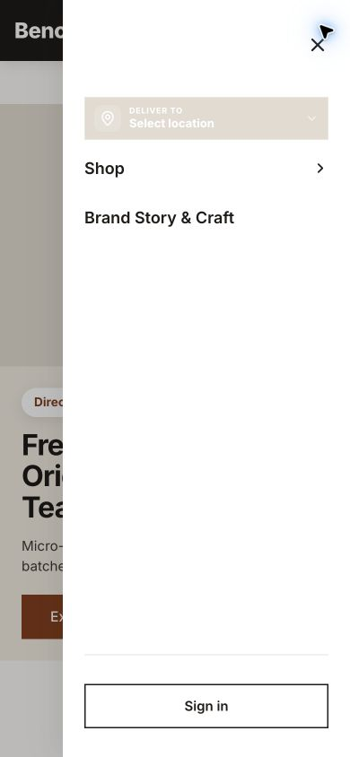

# Theme Studio production benchmark — 4 October 2026

The deployed builder is **not production-robust yet**. Five of eight fresh
themes reached candidate status; only two did so without an automatic design
revision. Successful completion took **33.73–75.92 minutes**, with a median of
**68.28 minutes**. Manual cart operations passed on all eight drafts, but shared
renderer contrast defects, worker memory exhaustion, queue delays and weak
visual-review evidence prevent a reliable completion or quality claim.

This is an internal validation record, not a product implementation. No
merchant-visible change, no Help Centre update. No themes were published and no
orders, payments, newsletter subscriptions or reviews were submitted.

## Deployment and method

- Production revision: `storemink-web-prod-00122-frg`, serving 100% of traffic.
- Deployed main commit: `a4a27a69757287bce08103d702035d7cd722ce33`.
- Web image digest: `sha256:68437ba8d17ebc192fd2028996ad317fccf26f00e82b3afa2bab53faf7ad0fc5`.
- Capture image digest: `sha256:3129eedefc651f9d2c4a9f5495a6f24ba88f5cfc9275df822064373fb139c304`.
- Model/provider: Gemini 3.8 Flash on Vertex; prompt `theme-studio-v22`, HIGH
  initial generation effort. Existing QA thresholds and provider configuration
  were retained.
- Eight new unpublished builds: two per industry across apparel, beauty, home
  goods and food. Synthetic briefs used normal Studio intake, without reference
  screenshots. At most two benchmark projects were unfinished concurrently.
- Browser acceptance covers six surfaces at 360, 390, 768, 1024 and 1440 pixels.
  All five candidates completed the final 30-sample browser pass. The three
  failures stopped during layout preflight before artwork generation.
- Authenticated Chrome inspection checked all eight fresh previews, mobile
  composition, tablet/desktop width, variant selection, cart quantity updates,
  totals and removal. Every test cart was emptied afterward.
- Existing themes were checked separately: Fashion, Luma, Vanta, Crave,
  Aurelle, Luxe and Bubble, plus the bundled Vitrine demo. Six received fresh
  full acceptance; published Luxe and bundled Vitrine received manual current
  preview checks only.

Fresh results were exported at `2026-10-04T06:55:25.669Z`; the final existing-theme
export was at `2026-10-04T07:16:49.730Z`. The observer's cloud credentials expired
overnight and were refreshed before the eighth submission. Seven builds ran
before this observation gap; the eighth ran afterward. This was **not a
continuous eight-theme load test**. The table measures each project's queue to
terminal result, including actual queues, retries, repairs and crash recovery;
the overnight batch elapsed time is not used as a generation metric.

Sanitized timings, run IDs, project/version IDs, gate findings, image outcomes,
worker errors, rate-limit events and individual design choices are retained in
[`full-live-2026-10-04.json`](../evals/theme-studio/full-live-2026-10-04.json).
Raw environment values, operator identities, credentials and private preview
links are excluded.

## Fresh builds

| Case                             | Result                | Minutes to result | Saved snapshots | Automatic design revisions | Image runs | Explanation                                                                                      |
| -------------------------------- | --------------------- | ----------------: | --------------: | -------------------------: | ---------: | ------------------------------------------------------------------------------------------------ |
| Apparel expressive (`fashion-a`) | Failed before artwork |              5.94 |               1 |                          1 |          0 | Discount badge contrast 2.58:1; repair returned `repair_not_supported`.                          |
| Apparel atelier (`fashion-b`)    | Candidate             |             43.26 |               4 |                          0 |          2 | Missing-slot fill completed artwork; one image retained unreviewed.                              |
| Botanical beauty (`beauty-a`)    | Failed before artwork |             34.88 |               2 |                          1 |          0 | Compare-price contrast improved 2.71→4.39:1, below 4.5; `qa_no_progress` stopped it.             |
| Cosmetics (`beauty-b`)           | Candidate             |             68.28 |               4 |                          1 |          1 | Initial hero contrast repaired; long image queue and worker recovery.                            |
| Ceramics (`home-a`)              | Candidate             |             33.73 |               4 |                          0 |          2 | Missing-slot fill completed artwork; all 16 final artwork reviews passed.                        |
| Lighting (`home-b`)              | Candidate             |             75.92 |               5 |                          1 |          2 | Worker recovery, hero repair and artwork fill; three flagged images and one unreviewed retained. |
| Pantry (`food-a`)                | Candidate             |             70.05 |               4 |                          1 |          1 | Hero repair, long image queue and worker recovery; one staging flag retained.                    |
| Roastery (`food-b`)              | Failed before artwork |             28.62 |               2 |                          2 |          0 | Delivery selector contrast 1.37:1; first settings repair ineffective, second `invalid_output`.   |

Snapshots include image saves and catalogue captures; they are not independent
creative revisions. Revision counts include attempted automatic revisions,
including failed ones. Failed-draft times are not successful completion times.
The observed candidate rate was **5/8 (62.5%)**; the first-pass rate without an
automatic design revision was **2/8 (25%)**. Candidate means automated eligibility
for operator review, not publication or independent visual approval.

Stored run estimates total **US$16.90715**, including image reviews but excluding
final whole-theme visual-review cost. This is stored pricing telemetry, not a
reconciled provider bill. The JSON retains visual token usage separately.

## Image generation

Five themes completed **84 artwork slots** and their three browser-captured
catalogue pictures each. There were **107 image draw calls** and **103 image
review calls**, including anchors and retakes. Of the retained artwork, **78
reviews passed, four were flagged and two remained unreviewed**.

| Case            | Draw calls | Review calls | Median draw excluding capacity wait | Final artwork review status        |
| --------------- | ---------: | -----------: | ----------------------------------: | ---------------------------------- |
| Apparel atelier |         21 |           18 |                             31.45 s | 16 passed, 1 unreviewed            |
| Cosmetics       |         21 |           21 |                             33.51 s | 17 passed                          |
| Ceramics        |         18 |           18 |                             31.47 s | 16 passed                          |
| Lighting        |         24 |           22 |                             32.41 s | 13 passed, 3 flagged, 1 unreviewed |
| Pantry          |         23 |           24 |                             36.45 s | 16 passed, 1 flagged               |

These draw times subtract each call's reported capacity wait; they are not pure
model inference latency. Summed waits overlap across concurrent calls and must
not be added to theme wall time.

Cloud logs recorded **97 `image_rate_limited_retry` events** during the observed
image window, with a maximum individual wait of **114.97 seconds**. These are
retry events, not 97 failed themes. Run-level `rateLimitDeferrals: 0` does not
mean there were no 429s: retries occurred inside image calls. Bounded recovery
worked, but provider capacity still materially affects throughput.

The lighting set retained a cut-off chandelier and off-centre/cropped tabletop
arrangement; a linen photo differed from the chosen SET staging. Its blanket
photo remained unreviewed. The atelier merino photo also remained unreviewed.
The pantry's kitchen-process image was flagged for depicting a kitchen rather
than product SET staging, although its brief describes cooking. That last case
needs purpose/reference-policy correction, not an arbitrary stricter retake.
The three preflight failures generated no artwork and cannot be graded as
successful image-generation tests.

## Existing eight-theme regression check

| Theme   | Current-build coverage                       | Result / remaining finding                                                                                                  |
| ------- | -------------------------------------------- | --------------------------------------------------------------------------------------------------------------------------- |
| Fashion | Full, 30 browser samples                     | Failed: 4 artwork + 3 catalogue placeholders, content crop 34%, PDP compare-price contrast 3.17:1.                          |
| Luma    | Full, 30 browser samples                     | Failed: 5 artwork + 3 catalogue placeholders; placeholder hero contrast and PDP compare-price contrast 3.27:1.              |
| Vanta   | Full, 30 browser samples                     | Passed every required gate.                                                                                                 |
| Crave   | Full, 30 browser samples                     | Failed: white text on gold PDP button, contrast 2.08:1.                                                                     |
| Aurelle | Full, 30 browser samples                     | Passed every required gate after a focused repeat of an incomplete capture.                                                 |
| Luxe    | Manual current preview, five widths and cart | Geometry and cart passed. Published-state UI disables new acceptance; earlier build 118 pass is not current-build evidence. |
| Bubble  | Full, 30 browser samples                     | Failed: 5 artwork + 3 catalogue placeholders, tablet home crop 33%, PDP compare-price contrast 3.26:1.                      |
| Vitrine | Bundled demo, manual five widths and cart    | Geometry/cart passed; mobile header breathing room and compact cards inspected. No Studio acceptance record.                |

Earlier incomplete Aurelle/Bubble captures and Luma route connection errors
were repeated through the normal UI. Their final records have all 30 browser
samples; Luma's transient route/link failure did not recur. Required remaining
failures were not hidden or reclassified as advisory. **Two of six** full
current-build existing-theme checks passed. Deployment does not fill legacy
artwork slots or redesign existing themes automatically.

## Commerce and variety

Manual cart checks passed on all eight new drafts, including the three with
placeholder artwork. Selected variants carried through, changing quantity
updated totals, and removal emptied the cart. For example, the atelier's
`2 (M) / Deep Charcoal` moved from two items at ₹16,800 to three at ₹25,200; the
roastery's `Pour Over / 500g` moved from ₹1,180 to ₹1,770. Botanical beauty was
tested from one to two items; the others from two to three. Luxe and Vitrine
also retained their chosen variants and correct updated totals. These checks
exercise preview commerce, not checkout/payment or fulfilment.

The eight final compiled packages used six design directions. Median pairwise
distinctness was **0.6545**, above the unchanged 0.45 target; **4/8** page colours
were outside the near-white band. Collection-banner choices now vary. However,
every draft still chose `pageWidth: wide` and `cardHoverImage: true`. The strict
Track V exit criterion remains **failed**. Including three unfinished drafts
measures authored layout variety, not eight finished artwork sets. The five
finished sets also often share warm, neutral photographic staging; reference
fidelity was not tested.

## Fix priorities supported by this run

### 1. Worker memory and crash recovery latency — P1

Production system logs contain **seven 1024 MiB memory-limit violations** and
**four worker `/runs` HTTP 503 requests explicitly attributed to memory
termination**. Existing browser acceptance ran on the same deployment, so this
does not establish a particular heap leak or exclusive attribution to images.
It does establish insufficient memory headroom under the observed workload.

The eighth run was claimed around 06:27 UTC, its container died at 06:31:55,
and lease recovery occurred around 06:48. Previously saved intent/draft
responses were reused; this protects paid work but leaves roughly 15 minutes
waiting for recovery. Lighting and cosmetics/pantry work also resumed after
worker loss. Profile image buffers/decoders and concurrent work, bound resident
memory, give generation workers appropriate isolated capacity, and shorten
dead-worker recovery without allowing two live owners. Raising memory alone
is not evidence that retention or concurrency is correct.

### 2. Contrast-safe shared rendering — P1

`homepage.css` and `shop.css` render discount labels with page ink on a
translucent white surface. On the dark apparel page that combination is only
2.58:1. The market-header delivery trigger inherits white header text even when
placed in a light mobile drawer, producing 1.37:1 in the roastery. A package
scalar edit cannot repair that surface/foreground mismatch. Legacy PDP compare
prices and Crave's CTA expose additional combinations missed by package-only
contrast validation.

Use contrast-safe token pairs for the actual rendered surface, test dark/light
header and drawer combinations, and validate badges/prices/buttons in the
browser. Preserve the 4.5:1 requirement and existing checks.

### 3. Queue utilization — P1

The runs route claims one item in each of two lanes and awaits both lanes plus
visual QA. Cloud Scheduler does not overlap an outstanding invocation. One
finished lane therefore stays idle behind a slow peer until a new invocation.
Observed image waits were 11.00, 18.00 and 18.95 minutes; botanical repair waited
17.95 minutes to execute for about 23 seconds. Faster cron frequency alone does
not solve this behavior.

Use durable independent dispatch or replenish a free lane within a bounded
request deadline. Retain shared provider admission, lease fencing and bounded
concurrency; do not detach paid work from an HTTP request that can be killed.

### 4. Repair progress must measure contrast improvement — P1

`qa-diagnosis.ts` counts contrast violations and normalizes away their ratios.
Botanical compare-price contrast improved from 2.71 to 4.39:1 but retained the
same selectors/count, so `visual-qa.ts` stopped it as `qa_no_progress`. It still
correctly fails 4.5:1. Store structured measured deficits and compare their
improvement; use deterministic supported palette correction where possible.
Repeated unsupported renderer findings should point to platform work without
creating futile theme revisions.

### 5. Legible visual-review inputs — P1

`visual-qa.ts` resizes each full page inside 760×760 pixels before placing six
pages on a 1600×2400 contact sheet. In the atelier's phone390 sheet, the home
page becomes **55 pixels wide**, shop 72, product 89, cart 170, content 62 and
404 page 199. Long home/content captures were already capped at 4096 pixels.
HIGH reasoning cannot restore detail discarded before the model receives it.

Atelier and ceramics received 5/5 on every model score, despite duplicated
main/footer newsletter forms found manually. The screenshot below reproduces
the actual sheet-building algorithm with the saved capture bytes. Send a
layout overview plus legible viewport/region crops with page/region labels;
benchmark known defective fixtures to prove the reviewer detects faults.

[Reproduced visual-review contact sheet](../evals/theme-studio/full-live-2026-10-04-assets/fashion-vision-contact-phone390.webp)

### 6. Image completion, throughput and review classification — P2

Keep bounded quota-aware admission/backoff and exact paid-image checkpoints;
measure retry/cooldown contributions separately from provider draw time and
queue time. Resolve retained review gaps explicitly. Classify editorial cooking
and craft scenes by their use, so product SET constraints do not contradict
their briefs. Do not claim that external provider 429s have been eliminated or
that flagged/unreviewed artwork is perfect.

### 7. Variety and content-quality completion — P2

Close the repeated width/hover choices against the original Track V exit bar;
do not weaken the criterion to declare success. Avoid duplicate newsletter
forms and unsupported invented endorsement/award claims. The cosmetics draft
included award/endorsement language absent from its synthetic brief. Add these
as authoring/review fixtures. Reference-fidelity tracks remain separate.

## What is established and what is not

Package validation, bounded stopping, saved-response recovery, final catalogue
capture on five candidates and preview cart operations worked in this run.
Fresh existing-theme tests also confirmed that Aurelle's earlier carousel/crop
blockers no longer fail its required checks. Focused local verification passed
76 unit tests and four rollback-only PostgreSQL tests; four unit tests were
skipped. This is not the full repository suite.

Eight fresh cases are insufficient to estimate production reliability. There
was no sustained multi-operator load, checkout/payment test, security penetration
test or screenshot-reference fidelity evaluation. An independent operator
still needs to judge the finished design. Fix the measured P1 failures, rerun
the same eight briefs against the new web **and** capture builds, and then run a
larger controlled concurrency/recovery batch before claiming a production-level
completion or latency guarantee. This benchmark does not implement those fixes.
